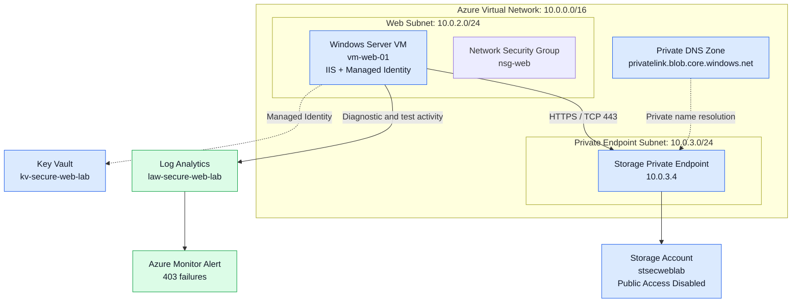

# Azure Secure Web Lab — Architecture

## Notes

- Storage public network access is disabled.
- The VM accesses Blob Storage through a Private Endpoint.
- Private DNS resolves the Blob endpoint to the private IP.
- Managed Identity is used for Azure resource access.
- Storage diagnostics are sent to Log Analytics.
- The Application Gateway was removed to reduce costs.
- The SQL Server component was not deployed.
